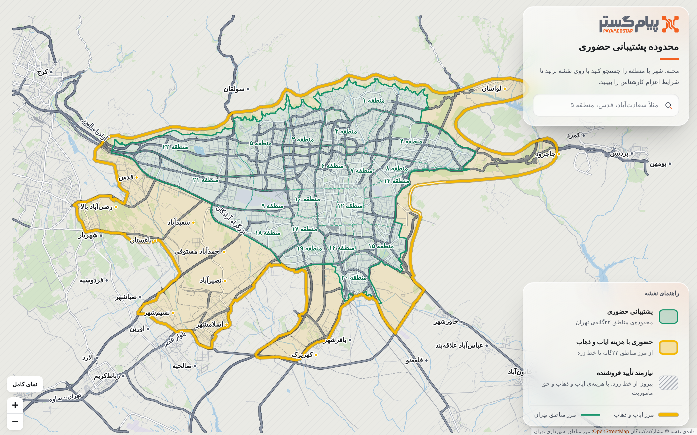

# نقشه محدوده پشتیبانی پیام‌گستر (TehranMap)

نقشه‌ی تعاملی که نشان می‌دهد پشتیبانی حضوری پیام‌گستر در تهران و اطراف با چه شرایطی انجام می‌شود. این مخزن همه‌چیز را نگه می‌دارد: کد، داده‌ها، تصاویر ورودی و مراحل ساخت، روش کار، آزمون و خطاها، اسکیل Claude برای به‌روزرسانی‌های بعدی و خروجی‌های نهایی (فایل HTML مستقل و افزونه‌ی وردپرس).



## سه لایه‌ی نقشه

| لایه | محدوده | شرط |
|---|---|---|
| پشتیبانی حضوری (سبز) | مناطق ۲۲گانه‌ی شهرداری تهران | بدون هزینه‌ی ایاب و ذهاب |
| حضوری با هزینه ایاب و ذهاب (زرد) | از مرز مناطق ۲۲گانه تا خط زرد | هزینه‌ی رفت‌وآمد کارشناس به فاکتور اضافه می‌شود |
| نیازمند تأیید فروشنده (هاشور خاکستری) | بیرون از خط زرد | با تأیید فروشنده، هزینه‌ی ایاب و ذهاب و حق مأموریت |

قابلیت‌ها: خیابان‌ها و بزرگراه‌های کل منطقه با اسم، جستجوی محله و شهر و منطقه، نمایش شرط پشتیبانی با بردن موس روی نقشه، استعلام با زدن روی هر نقطه، راهنمای رنگ، باکس‌های شیشه‌ای با لوگوی پیام‌گستر، کار بدون اینترنت و بدون سرویس نقشه‌ی بیرونی.

## خروجی‌های آماده

- [`dist/payamgostar-support-map.html`](dist/payamgostar-support-map.html): یک فایل مستقل (حدود ۳٫۵ مگابایت) که همه‌ی داده‌ها را دارد. با مرورگر باز کنید یا روی هر سایتی بگذارید.
- [`dist/wordpress/payamgostar-support-map-5.0.0.zip`](dist/wordpress/): افزونه‌ی وردپرس با شورت‌کد `[payamgostar_support_map]` و بلوک «نقشه محدوده پشتیبانی». راهنما: [docs/06-wordpress-plugin.md](docs/06-wordpress-plugin.md)

## ساختار مخزن

```
README.md                  همین فایل
docs/                      مستندات (روش، داده، دستور عمل ساخت، آزمون و خطا، نسخه‌ها، وردپرس)
skill/tehran-support-map/  اسکیل Claude برای به‌روزرسانی نقشه (مثلاً وقتی مرز دوباره کشیده می‌شود)
src/template.html          منبع اصلی صفحه (CSS + منطق نقشه)؛ هر تغییری از اینجا شروع می‌شود
src/template-v1.html       نسخه‌ی اول (بدون خیابان) برای مرجع
app/                       پروژه‌ی React که template را بسته‌بندی می‌کند (web-artifacts-builder)
scripts/                   همه‌ی اسکریپت‌های پایتون/نود، به ترتیب نسخه‌ها
tools/setup_work.sh        ساخت پوشه‌ی کاری از داده‌های مخزن
tools/build.sh             ساخت کامل: صفحه‌ی HTML نهایی + zip وردپرس
data/                      داده‌ها: مرز مناطق، مرز زرد، داده‌ی خیابان OSM، لوگو، فایل‌های تطبیق تصویر
images/inputs/             تصاویری که برای ساخت فرستاده شد (نقشه‌های مرجع، خطوط دستی)
images/process/            تصاویر مراحل میانی (تطبیق، استخراج خط، مقایسه)
images/screens/            اسکرین‌شات هر نسخه
images/brand/              لوگوهای پیام‌گستر
dist/                      خروجی‌های نهایی
```

## ساخت سریع

```bash
bash tools/build.sh
```

پیش‌نیاز: Python 3 با `numpy shapely pyproj osmium opencv-python-headless scikit-image networkx pyshp`، Node 18+ و pnpm. جزئیات در [docs/03-build-runbook.md](docs/03-build-runbook.md).

## مستندات

1. [روش ساخت نقشه](docs/01-methodology.md)
2. [منابع داده و مجوزها](docs/02-data-sources.md)
3. [دستور عمل ساخت و به‌روزرسانی](docs/03-build-runbook.md)
4. [آزمون و خطاها و درس‌ها](docs/04-lessons-and-errors.md)
5. [تاریخچه‌ی نسخه‌ها](docs/05-versions.md)
6. [افزونه‌ی وردپرس](docs/06-wordpress-plugin.md)

## مجوز داده‌ها

داده‌ی خیابان‌ها © مشارکت‌کنندگان OpenStreetMap، با مجوز ODbL. ذکر منبع در خود نقشه نمایش داده می‌شود. مرز مناطق از لایه‌ی مناطق ۲۲گانه‌ی شهرداری تهران است. لوگو و هویت بصری متعلق به پیام‌گستر است.
