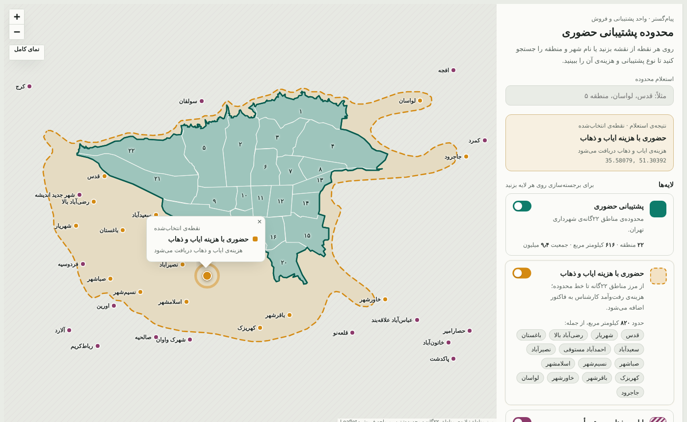
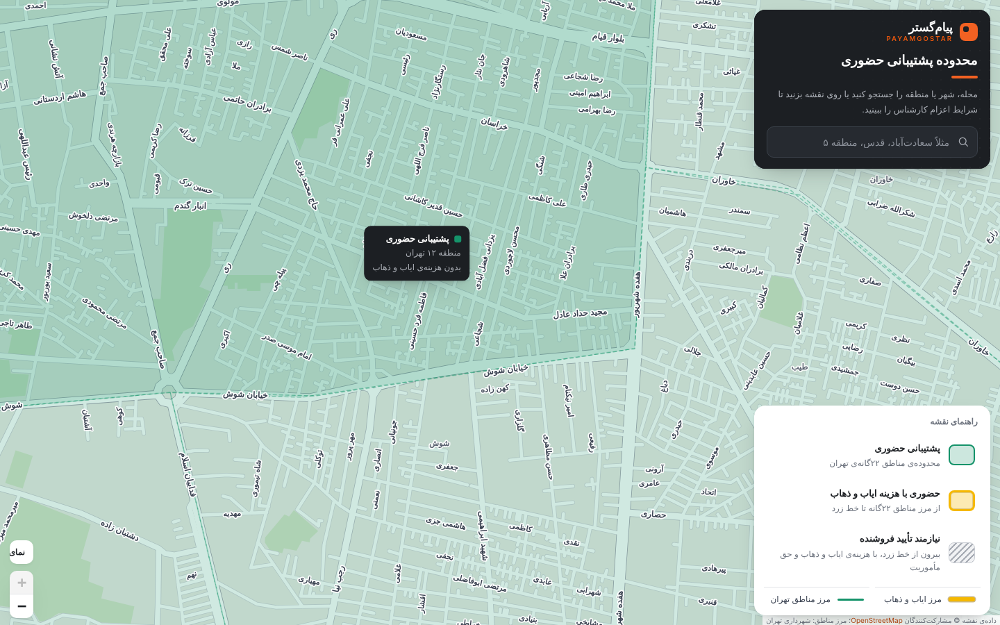
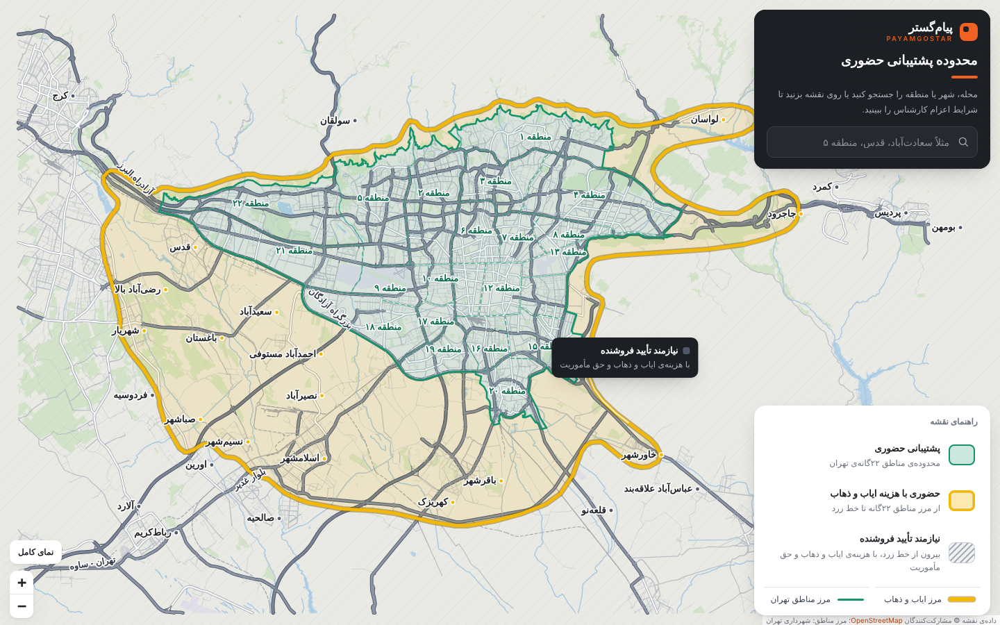
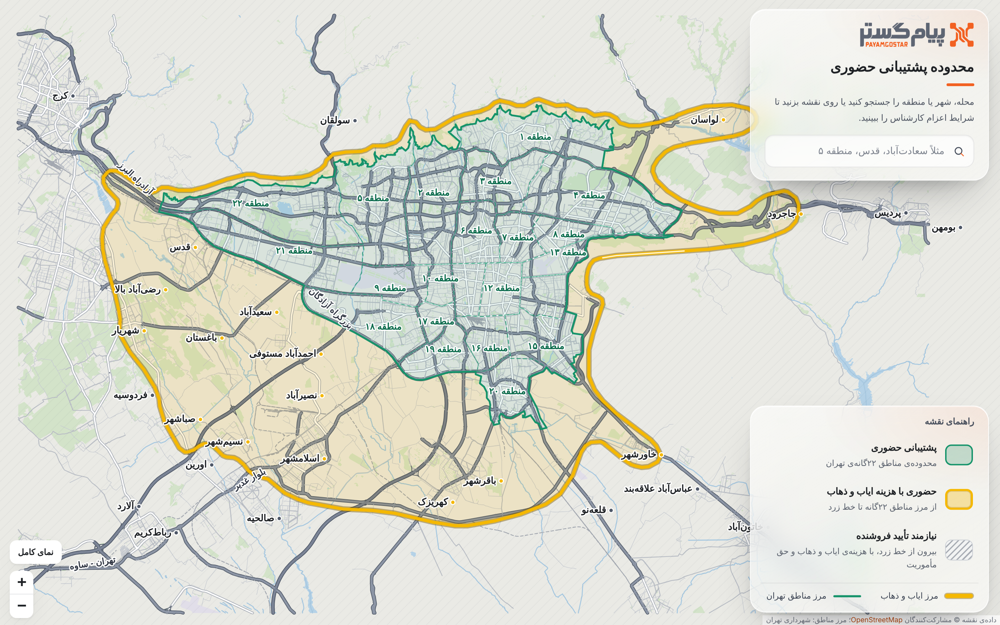
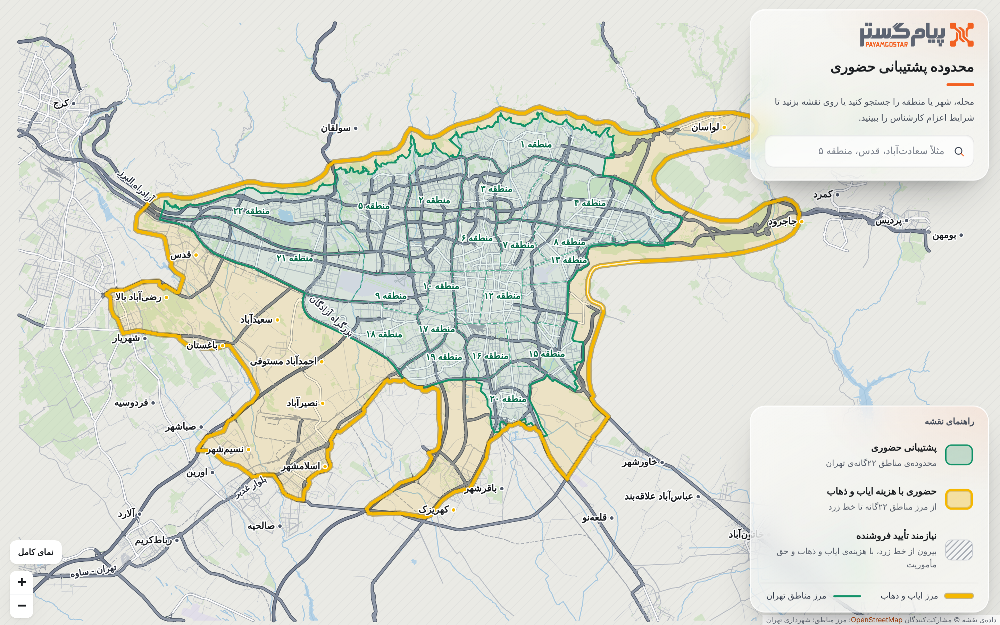

# تاریخچه‌ی نسخه‌ها

## نسخه‌ی ۱ — نقشه‌ی سه‌لایه‌ی اولیه

- مرز مناطق از شیپ‌فایل و مرز زرد از خط دستی روی گوگل‌مپ (تطبیق با برچسب شهرها).
- Leaflet بدون نقشه‌ی پایه، چون تایل‌ها مسدود بودند.
- **بازخورد کاربر:** بدون خیابان مشتری نمی‌فهمد کجاست. جمعیت مهم نیست. متن هر لایه روی موس باید بیاید. هویت بصری پیام‌گستر لازم است و مرز زرد باید پررنگ باشد.

## نسخه‌ی ۲ — خیابان‌ها (مرکز تهران)

- نقشه‌ی پایه‌ی برداری از OSM روی canvas، با برچسب جاده‌ها و محله‌ها.
- برچسب روی موس برای هر سه لایه، راهنمای رنگ ثابت و مرز زرد متحرک.
- رنگ‌های زغالی و نارنجی پیام‌گستر. ساخت با web-artifacts-builder (React) و frontend-design.
- **مشکل:** داده فقط مرکز تهران را داشت و بیرون از Claude کار نمی‌کرد.

## نسخه‌ی ۳ — پوشش کامل و فایل مستقل

- برش سفارشی OSM برای کل منطقه، از کرج تا پردیس.
- داده‌ی خیابان‌ها داخل HTML (gzip+base64). فایل بدون سرور هم باز می‌شود.

## نسخه‌ی ۴ — باکس‌های شیشه‌ای و لوگوی رسمی

- لوگوی وکتورشده، باکس‌های شیشه‌ای، ورود متحرک، تعلیق ملایم و برق نور.
- راهنما در موبایل جمع‌شده و کنترل‌های زوم بالای آن.

## نسخه‌ی ۵ — مرز زرد جدید (فعلی)

- خط دستی جدید کاربر روی نقشه‌ی خودمان: محدودتر در غرب و جنوب.
- چسباندن به جاده‌های اصلی و مرز مناطق. مساحت لایه‌ی ۲ از حدود ۱٬۴۳۰ به ۱٬۱۳۰ کیلومتر مربع رسید.
- شهریار، صباشهر، باقرشهر و خاورشهر به لایه‌ی ۳ رفتند.
- افزونه‌ی وردپرس 5.0.0.

## کارهای باز
- فونت یکان بخ، وقتی فایل فونت برسد.
- صاف کردن دو پله‌ی ریز کنار اسلامشهر، اگر لازم شد.
- تأیید فهرست شهرهایی که لایه‌شان در نسخه‌ی ۵ عوض شد.
